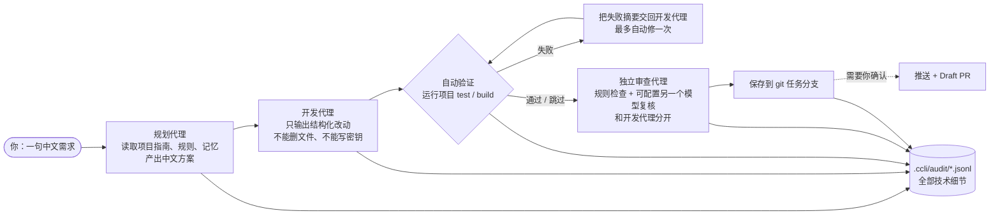

<!-- 命名待定：仓库目前叫 ck-cli，命令叫 ccli。候选名见 PR 描述，选定后全局替换。 -->

<h1 align="center">ccli</h1>

<p align="center"><b>不会写代码？用中文说一句需求，一支 AI 开发小队帮你把网站做出来。</b></p>

<p align="center">
  <a href="LICENSE"></a>
  = 20" src="https://img.shields.io/badge/node-%3E%3D20-brightgreen.svg">
  <a href="https://github.com/frankford824/ck-cli/stargazers"></a>
  <a href="docs/README_en.md"></a>
</p>

<p align="center">
  <a href="#一行安装">安装</a> ·
  <a href="#30-秒上手">30 秒上手</a> ·
  <a href="#它是怎么工作的">工作原理</a> ·
  <a href="#和-claude-code--cursor--codex-有什么区别">和 Claude Code 的区别</a> ·
  <a href="docs/COMMANDS.md">全部命令</a>
</p>

---

ccli 面向**不写代码的人**：老板、运营、门店主、自由职业者。你只负责说"要什么"和"满不满意"，它负责规划、开发、验证、审查、保存。
屏幕上只出现任务、进度、风险、选择和结果；代码、命令、diff、路径和报错全部写进本地审计日志，想看再看。

## 你是不是也卡在这里

| 你想…… | 结果 |
| --- | --- |
| 给门店做个预约页，客户能选时间、你能看预约 | 外包报价几万、工期一个月，于是一直没做 |
| 让 ChatGPT 帮你写 | 它回你一屏代码和 `npm install`，你不知道该贴到哪 |
| 装了 Claude Code / Cursor | 满屏英文 diff、分支、终端报错，第二天就不想再打开 |
| 让 AI 改了一个地方 | 不知道它还顺手动了什么，更不知道怎么退回去 |
| 还没申请到模型 API Key | 工具直接罢工，连个页面都看不到 |
| 东西做好了想给同事看 | 不知道"推送""PR""合并"是什么，不敢点 |

ccli 的做法：**说中文、看页面、不满意就改、改坏了就撤回**。其余交给流程。

## 一行安装

macOS / Linux：

```bash
curl -fsSL https://raw.githubusercontent.com/frankford824/ck-cli/main/install.sh | bash
```

Windows PowerShell：

```powershell
irm https://raw.githubusercontent.com/frankford824/ck-cli/main/install.ps1 | iex
```

安装器会自己准备 Node.js（≥ 20）和 pnpm，没有 Git 也能装。装完重新打开终端，输入 `ccli` 就能看到中文首页。
卸载：把上面地址里的 `install` 换成 `uninstall` 再执行一次。

## 30 秒上手

**第 1 步，先不配任何 Key，试一下：**

```bash
ccli try
```

它会在本机试用区（`~/.ccli/tryouts/`）生成一个客户管理演示产品并打开浏览器页面。不动你当前目录，不需要模型授权。

**第 2 步，说你自己的需求：**

```bash
ccli go "做一个门店预约系统，客户能选时间，老板能看预约"
```

没有 Key 时，ccli 会按"预约 / 客户 / 库存 / 订单 / 财务 / 内容"这几类常见场景离线生成一个能打开的首版工作台；配了 Key 之后，再由模型按你的话定制。

**第 3 步，配上模型，让它真的替你写：**

```bash
ccli setup
```

选一家模型服务、粘贴授权码，之后所有项目自动继承。然后就可以直接说话了：

```bash
ccli "给订单页面增加导出按钮"
ccli "首页太乱，重点不够明显"
ccli undo          # 刚才改坏了？撤回上一次保存的成果
ccli report        # 给我一页中文进度汇报
```

> 完整命令清单（向导、追问卡、验收凭证、驾驭系统、语音硬件协议等）见 [docs/COMMANDS.md](docs/COMMANDS.md)。

## 演示

<!-- TODO: 录制 GIF 后替换下面这行。建议用 vhs 或 terminalizer，1280×720，≤ 30 秒。
画面：
  1. 空终端输入 `ccli go "做一个门店预约系统，客户能选时间，老板能看预约"`
  2. 依次出现中文进度：正在了解当前项目 → 正在整理实现方案 → 正在实现功能 → 正在验证是否正常 → 正在进行独立审查 → 本次成果已保存
  3. 浏览器自动弹出预约工作台页面，停 3 秒
  4. 切回终端输入 `ccli "首页加一个今日预约数"`，页面刷新出现新卡片
  5. 最后输入 `ccli undo`，页面回到上一版
全程不出现任何代码、命令或英文报错。 -->


## 它是怎么工作的

每一句需求都会走同一条流水线。模型只在"规划""开发""审查"三个环节说话；"验证"是确定性的，跑的是项目自己的 `test` 和 `build`。



几条硬规则，写在代码里而不是提示词里：

- 每个任务自动开一个 git 分支，保存即提交，所以 `ccli undo` 有据可退。
- 开发代理只能返回 JSON 形式的文件改动（`action` 只允许 `write`），由 ccli 落盘；它不执行 shell。
- 规划、开发、审查三个角色可以绑定不同模型（`~/.ccli/config.json` 里的 `roles`），审查不必信任开发。
- 进度写到 `.ccli/progress.json`，中断后 `ccli resume` 接着来；踩过的坑写到 `.ccli/harness/agent-memory/LESSONS.md`，下次开工前自动读取。

## 支持的模型

| 服务 | 环境变量 | 内置默认模型 |
| --- | --- | --- |
| OpenAI | `OPENAI_API_KEY` | `gpt-5`、`gpt-5-mini` |
| Anthropic | `ANTHROPIC_API_KEY` | `claude-sonnet-4-5`、`claude-opus-4-1` |
| Google Gemini | `GOOGLE_API_KEY` / `GEMINI_API_KEY` | `gemini-3-pro`、`gemini-2.5-pro` |
| 通义千问 Qwen | `QWEN_API_KEY` / `DASHSCOPE_API_KEY` | `qwen3-coder-plus`、`qwen-plus` |
| DeepSeek | `DEEPSEEK_API_KEY` | `deepseek-chat`、`deepseek-reasoner` |
| Kimi | `KIMI_API_KEY` / `MOONSHOT_API_KEY` | `kimi-latest`、`kimi-k2` |

`ccli setup --provider deepseek --api-key "你的授权码"` 可以非交互配置。Key 存在本机 `~/.ccli/config.json` 或环境变量里；`ccli config show` 会把它打码显示，新项目的 `.gitignore` 模板默认排除 `.ccli/audit/`。

## 安全设计

普通用户看不见命令，不代表命令可以乱跑。策略层（`packages/policy`）对每个动作先定级再执行：

| 动作 | 处理 |
| --- | --- |
| `rm -rf`、`git reset --hard`、`git clean -fd`、`chmod -R 777`、`sudo rm` | **直接阻止**，不询问 |
| 删除文件、推送、创建 PR、合并、部署、`npm publish`、`docker push` | 高风险，**必须中文确认**或显式 `--yes` |
| 读写 `.env`、`*.pem`、`*.key`、`id_rsa`、含 `secret` / `credential` 的文件 | 高风险，必须确认 |
| `curl ... \| bash` 这类远程脚本 | 高风险，必须确认 |
| `drop database`、`truncate table`、迁移命令 | 高风险，必须确认 |
| 安装依赖 | 中风险，自动执行并记录 |

所有工具调用、模型原始输出、策略判定都追加写入 `.ccli/audit/*.jsonl`。`ccli audit --expert` 可以查看；共享项目前可以用 `ccli harness --scan` 扫一遍疑似密钥和过宽权限。

## 和 Claude Code / Cursor / Codex 有什么区别

它们都很好，但它们假设你会写代码。ccli 假设你不会。

| | Claude Code / Cursor / Codex | ccli |
| --- | --- | --- |
| 目标用户 | 工程师 | 老板、运营、不写代码的人 |
| 界面语言 | 英文为主 | 全中文，包括错误提示 |
| 屏幕上出现什么 | 代码、diff、命令、堆栈 | 任务、进度、风险、选择、结果 |
| 出了问题 | 你读报错、你决定 | 它说"遇到问题，已记录"，你说"撤回" |
| 怎么验收 | 看代码、跑测试 | 打开页面看，`ccli accept` 给中文清单 |
| 模型 | 绑定自家 | OpenAI / Anthropic / Gemini / Qwen / DeepSeek / Kimi 任选，国产模型开箱可用 |
| 没有 Key | 用不了 | 能离线生成首版页面 |

如果你是工程师，ccli 对你最有用的部分可能是 `ccli harness --init`：它把"项目指南 + 规则 + 技能 + 独立审查 + 进度记忆 + 失败经验"这套支架一键铺到任何已有项目里。ccli 启动时会读 `AGENTS.md` / `CLAUDE.md`，所以和 Claude Code 可以共用同一份项目指南。

## Roadmap

当前状态：可用的原型，核心流水线、策略层、审计、六家模型适配、离线首版都已实现并有测试覆盖。下面是接下来的计划，不是已完成项：

- [ ] 发布到 npm，支持 `npx` 直接试用，不必走安装脚本【待确认包名】
- [ ] 录制演示 GIF / 3 分钟视频
- [ ] 在干净的 macOS / Windows 机器上跑一遍安装脚本并补 CI
- [ ] 英文界面模式（当前只有中文）
- [ ] 更多首版模板：小程序 / 移动端布局
- [ ] 语音与智能硬件接入：`ccli hardware` 协议已预留，等待第一块板子

有想法请开 issue，或者直接告诉 ccli：`ccli learn "以后……"`。

## 贡献

```bash
git clone https://github.com/frankford824/ck-cli.git
cd ck-cli
pnpm install
pnpm build
pnpm test
pnpm dev --help
```

- 仓库是 pnpm monorepo：`apps/cli` 是入口，`packages/*` 是可独立测试的模块（agent-core、policy、providers、review、harness、memory……）。
- 改动前请读 [`AGENTS.md`](AGENTS.md)：普通模式只能出现中文自然语言，高影响动作必须经过策略层。
- 提 PR 请附上 `pnpm test` 结果。欢迎的方向：新的模型适配、新的首版场景模板、安装脚本在不同系统上的修复。

## License

[MIT](LICENSE) © 2026 Wenkun Fu
