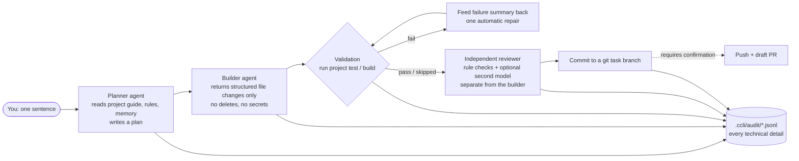

<!-- Naming TBD: the repo is ck-cli, the command is ccli. Candidate names are in the PR description. -->

<h1 align="center">ccli</h1>

<p align="center"><b>Can't code? Describe what you want in plain Chinese and a small AI dev team builds the web app for you.</b></p>

<p align="center">
  <a href="../LICENSE"></a>
  
  <a href="https://github.com/frankford824/ck-cli/stargazers"></a>
  <a href="../README.md"></a>
</p>

> **Note:** the user-facing interface is Chinese only for now. This document explains what ccli does and how it is built; an English UI mode is on the roadmap.

---

ccli is a coding agent CLI for **people who do not write code**: small-business owners, operators, shop keepers, freelancers. You say what you want and whether you like the result; ccli plans, builds, validates, reviews and saves.
The screen only ever shows tasks, progress, risks, choices and outcomes. Code, shell commands, diffs, file paths and stack traces go to a local audit log you can open when you want to.

## The problems it is built for

| You want to… | What usually happens |
| --- | --- |
| Build a booking page for your shop | An agency quotes thousands and a month; it never gets done |
| Ask ChatGPT to write it | You get a screen of code and `npm install`, with nowhere to paste it |
| Install Claude Code / Cursor | English diffs, branches and terminal errors; you never open it again |
| Let an AI change one thing | You have no idea what else it touched, or how to go back |
| Try before you have an API key | The tool refuses to do anything |
| Show the result to a colleague | "Push", "PR", "merge" mean nothing to you |

ccli's answer: **speak Chinese, look at the page, ask for changes, undo if it broke**. The pipeline handles the rest.

## One-line install

macOS / Linux:

```bash
curl -fsSL https://raw.githubusercontent.com/frankford824/ck-cli/main/install.sh | bash
```

Windows PowerShell:

```powershell
irm https://raw.githubusercontent.com/frankford824/ck-cli/main/install.ps1 | iex
```

The installer provisions Node.js (≥ 20) and pnpm itself and works without Git. Reopen the terminal and type `ccli`.
To uninstall, run the same URL with `install` replaced by `uninstall`.

## 30-second tour

**1. Try it with no API key:**

```bash
ccli try
```

Creates a demo CRM product under `~/.ccli/tryouts/` and opens it in the browser. Your current directory is untouched.

**2. Say what you want:**

```bash
ccli go "做一个门店预约系统，客户能选时间，老板能看预约"
# "build a shop booking system: customers pick a slot, the owner sees bookings"
```

Without a key, ccli generates a working first version offline for common scenarios (booking / CRM / inventory / orders / finance / content). With a key, the model tailors it to your sentence.

**3. Connect a model:**

```bash
ccli setup
```

Pick a provider, paste a key once, every project inherits it. Then just talk:

```bash
ccli "给订单页面增加导出按钮"   # add an export button to the orders page
ccli undo                       # roll back the last saved result
ccli report                     # one-page progress report in Chinese
```

> Full command reference (wizard, clarifying questions, acceptance receipts, harness tooling, voice/hardware protocol): [docs/COMMANDS.md](COMMANDS.md) (Chinese).

## Demo

<!-- TODO: replace with the recorded GIF. Same storyboard as the Chinese README: `ccli go …` → Chinese progress lines → browser opens → one change request → `ccli undo`. -->


## How it works

Every request goes through the same pipeline. Models speak only in *plan*, *build* and *review*; *validate* is deterministic and runs the project's own `test` and `build` scripts.



Hard rules live in code, not in prompts:

- Each task gets its own git branch and a commit on save, so `ccli undo` always has something to revert to.
- The builder can only return JSON file writes (`action: write`); it never gets a shell.
- Planner, builder and reviewer can be bound to different models (`roles` in `~/.ccli/config.json`), so the reviewer does not have to trust the builder.
- Progress is persisted to `.ccli/progress.json` (`ccli resume` continues after an interruption); lessons go to `.ccli/harness/agent-memory/LESSONS.md` and are read before the next task.

## Supported models

| Provider | Env var | Built-in defaults |
| --- | --- | --- |
| OpenAI | `OPENAI_API_KEY` | `gpt-5`, `gpt-5-mini` |
| Anthropic | `ANTHROPIC_API_KEY` | `claude-sonnet-4-5`, `claude-opus-4-1` |
| Google Gemini | `GOOGLE_API_KEY` / `GEMINI_API_KEY` | `gemini-3-pro`, `gemini-2.5-pro` |
| Qwen | `QWEN_API_KEY` / `DASHSCOPE_API_KEY` | `qwen3-coder-plus`, `qwen-plus` |
| DeepSeek | `DEEPSEEK_API_KEY` | `deepseek-chat`, `deepseek-reasoner` |
| Kimi | `KIMI_API_KEY` / `MOONSHOT_API_KEY` | `kimi-latest`, `kimi-k2` |

Non-interactive: `ccli setup --provider deepseek --api-key "..."`. Keys live in `~/.ccli/config.json` or env vars; `ccli config show` masks them; generated projects ignore `.ccli/audit/` by default.

## Safety

Hiding commands from the user does not mean commands run unchecked. The policy layer (`packages/policy`) classifies every operation before it executes:

| Operation | Handling |
| --- | --- |
| `rm -rf`, `git reset --hard`, `git clean -fd`, `chmod -R 777`, `sudo rm` | **Blocked**, no prompt |
| Delete files, push, create PR, merge, deploy, `npm publish`, `docker push` | High risk, **requires explicit confirmation** or `--yes` |
| Touching `.env`, `*.pem`, `*.key`, `id_rsa`, anything named `*secret*` / `*credential*` | High risk, requires confirmation |
| `curl … \| bash` style remote scripts | High risk, requires confirmation |
| `drop database`, `truncate table`, migration commands | High risk, requires confirmation |
| Installing dependencies | Medium risk, auto-run and logged |

Every tool call, raw model output and policy decision is appended to `.ccli/audit/*.jsonl`. `ccli audit --expert` shows it; `ccli harness --scan` checks a project for leaked secrets and over-broad permissions before you share it.

## How is this different from Claude Code / Cursor / Codex?

They are excellent — and they assume you can code. ccli assumes you can't.

| | Claude Code / Cursor / Codex | ccli |
| --- | --- | --- |
| Audience | Engineers | Owners, operators, non-programmers |
| UI language | English | Chinese, including every error message |
| What's on screen | Code, diffs, commands, stack traces | Tasks, progress, risks, choices, results |
| When something breaks | You read the error and decide | "Something went wrong, it's logged." You say "undo". |
| Acceptance | Read the code, run tests | Open the page; `ccli accept` gives a Chinese checklist |
| Models | Vendor-locked | OpenAI / Anthropic / Gemini / Qwen / DeepSeek / Kimi — Chinese providers work out of the box |
| No API key | Nothing works | Offline first version still renders |

If you *are* an engineer, the most useful piece is probably `ccli harness --init`: it lays down a project guide, rules, skills, an independent reviewer, progress memory and a lessons file in any existing repo. ccli reads `AGENTS.md` / `CLAUDE.md` at start-up, so it can share one project guide with Claude Code.

## Roadmap

Current state: a working prototype. The pipeline, policy layer, audit log, six provider adapters and offline first version are implemented and covered by tests. Planned, not done:

- [ ] Publish to npm so `npx` works without the install script (package name TBD)
- [ ] Record the demo GIF / a 3-minute video
- [ ] Run the installers on clean macOS / Windows machines and add CI
- [ ] English UI mode
- [ ] More first-version templates: mini-program / mobile layouts
- [ ] Voice and smart-hardware front-ends: the `ccli hardware` protocol is already reserved

## Contributing

```bash
git clone https://github.com/frankford824/ck-cli.git
cd ck-cli
pnpm install
pnpm build
pnpm test
pnpm dev --help
```

- pnpm monorepo: `apps/cli` is the entry point, `packages/*` are independently tested modules (agent-core, policy, providers, review, harness, memory, …).
- Read [`AGENTS.md`](../AGENTS.md) first: normal mode may only show Chinese natural language, and every high-impact action must pass the policy layer.
- Attach `pnpm test` output to PRs. Welcome: new provider adapters, new first-version scenario templates, installer fixes on other systems.

## License

[MIT](../LICENSE) © 2026 Wenkun Fu
